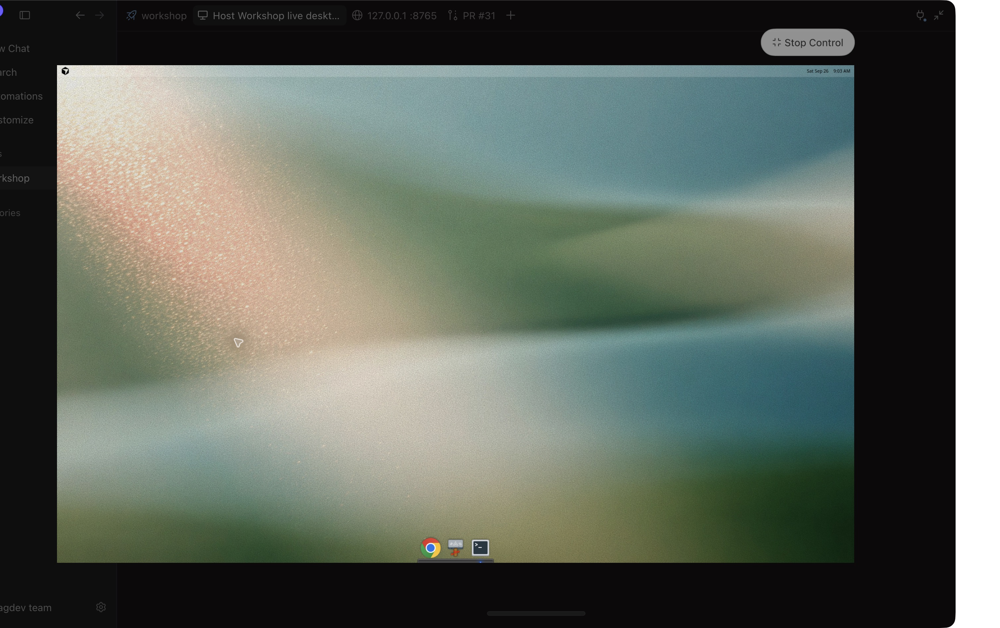
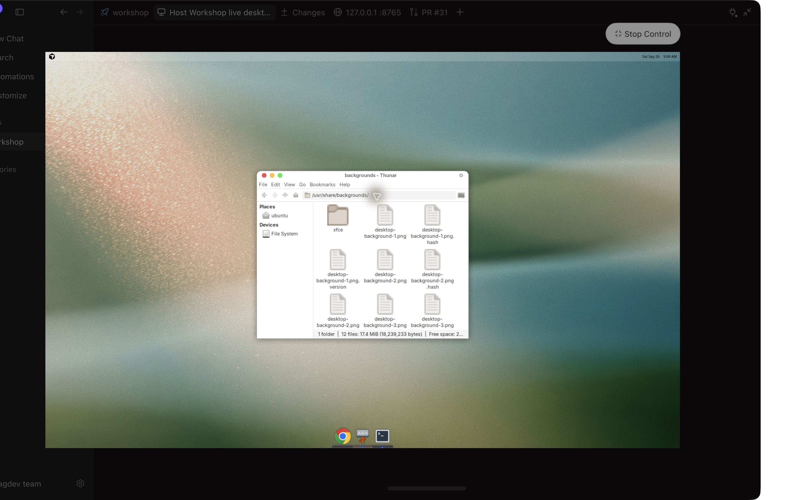

# cursorvmdotfiles

The desktop look from a Cursor cloud VM, captured so it can be recreated on another Linux machine.

I liked how familiar the VM felt as a macOS user: a slim top bar, a centered dock, light windows, and traffic-light window buttons. I opened its terminal to understand how it was put together, inspected the installed packages and desktop settings, and exported the dotfiles, themes, fonts, and original wallpaper.

Underneath, it is **Ubuntu 24.04.4 with XFCE**, styled with **WhiteSur Light**, **WhiteSur icons and cursors**, and a **Plank dock**. The interface uses **Inter**, while the terminal uses **JetBrains Mono**. Thunar handles files. The macOS familiarity comes from this combination of ordinary Linux desktop components.

## Recreate the look

For a fresh laptop, give your coding agent this repo and start with [AGENTS.md](AGENTS.md) and [FRESH_INSTALL.md](FRESH_INSTALL.md): download and verify Ubuntu, prepare a USB, install Linux, then run the included appearance setup after booting. The reboot/install step may need your hands. For an existing desktop, use [RESTORE.md](RESTORE.md). Ubuntu with an XFCE/X11 session is the closest match. Other Linux distributions can use the same assets with XFCE and Plank, but package names, display settings, and paths may need adjustment. This is not a universal installer or a replacement operating system.

## Included

- `AGENTS.md` and `FRESH_INSTALL.md`: the two-stage agent workflow, from ISO and USB to the installed desktop.
- `scripts/`: per-user appearance installer and first-login setup, with backups and a dry-run mode.

- `capture/bundle/home/home/ubuntu/.config/`: XFCE, GTK, terminal, and Plank dotfiles.
- `capture/bundle/system/usr/share/`: wallpaper, themes, icons, cursors, fonts, dock themes, and application launcher references.
- `capture/bundle/manifest/`: package versions, font inventory, readable settings, and Plank dconf export.
- `capture/appearance.tar.gz`: unchanged original export.
- `capture/*.png`: desktop, file-manager, and additional Workshop session screenshots.
- `CAPTURE-MANIFEST.json`: file hashes and symlink targets for checking the capture.

Captured on **September 26, 2026**. The original archive and copied files are verified; a complete restore on a fresh Linux installation has not been tested. This preserves the desktop appearance, not Cursor's cloud infrastructure or agent services.

Unofficial personal reference. Third-party assets retain their original ownership and terms; see [PROVENANCE.md](PROVENANCE.md).
